<p align="center">
  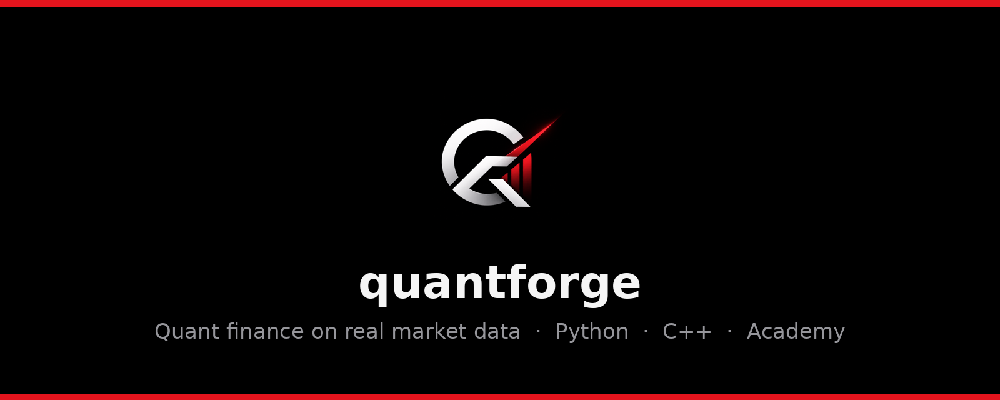
</p>

<p align="center">
  <b>English</b> · <a href="docs/fr/LISEZMOI.md">Français</a>
</p>

<p align="center">
  <a href="https://github.com/YOUR_GITHUB_USERNAME/quantforge/actions/workflows/ci.yml"></a>
  <a href="https://github.com/YOUR_GITHUB_USERNAME/quantforge/releases"></a>
  
  
  
  <a href="LICENSE"></a>
  <a href="https://github.com/YOUR_GITHUB_USERNAME/quantforge/stargazers"></a>
</p>

<p align="center">
  <a href="#-quick-start"><b>🚀 Quick start</b></a> ·
  <a href="#-whats-inside"><b>🧰 Tools</b></a> ·
  <a href="docs/tutorials"><b>📚 Tutorials</b></a> ·
  <a href="#-academy"><b>🎓 Academy</b></a> ·
  <a href="https://github.com/YOUR_GITHUB_USERNAME/quantforge/releases"><b>⬇️ Download</b></a> ·
  <a href="https://github.com/YOUR_GITHUB_USERNAME/quantforge/discussions"><b>💬 Discussions</b></a> ·
  <a href="https://www.linkedin.com/in/marin-ventalon"><b>👤 Creator</b></a>
</p>

---

**quantforge** is an open-source quantitative-finance platform built on **real market data
only**: a Python library, a multithreaded **C++17 pricing engine**, a 25-page research web app,
**paper trading** with $1,000,000 of virtual money, and an **Academy** that takes you from
*what is a stock* to writing your own pricing engine, with verifiable certificates.

> **Real numbers, nothing invented.** Prices, option chains, rates and fundamentals come from
> Yahoo Finance, FRED, Massive (Polygon), FMP or Alpha Vantage. Every dataset shows its source
> and download time. If a source fails, you see the error; quantforge never fills the gap with
> made-up data.

## 📑 Contents

* [Quick start](#-quick-start): install in three commands, or double-click to launch
* [What's inside](#-whats-inside): every tool, with screenshots
* [Use it as a library](#-use-it-as-a-library)
* [Using the C++ engine](#-using-the-c-engine) · [Academy curriculum](#-academy-curriculum) · [Validation](#-validation)
* [Documentation](#-documentation) · [Contributing](#-contributing) · [Disclaimer](#-disclaimer)

## 🚀 Quick start

```bash
git clone https://github.com/YOUR_GITHUB_USERNAME/quantforge.git
cd quantforge
pip install -e ".[all]"
quantforge-app
```

Your browser opens on **http://localhost:8501**.

**Prefer not to use the terminal?** Download the ZIP, unzip it and
double-click `Start quantforge.command` (macOS: right-click → **Open** the first time) or
`Start quantforge.bat` (Windows). The first launch installs everything automatically.

<details>
<summary><b>Step-by-step install (beginners, macOS · Windows · Linux)</b></summary>

1. Install **Python 3.10+** from [python.org](https://www.python.org/downloads/). On Windows,
   tick *Add Python to PATH*.
2. Download the project: green **Code** button → **Download ZIP**, then unzip it. Or use `git clone`.
3. Open a terminal in the `quantforge` folder and run:

   ```bash
   python -m venv .venv
   source .venv/bin/activate        # Windows: .venv\Scripts\activate
   pip install -e ".[all]"
   quantforge-app
   ```

4. Optional, for the C++ engine: install a compiler (macOS: `xcode-select --install`,
   Windows: *Visual Studio Build Tools*, Linux: `sudo apt install g++`) and run
   `quantforge-build-native`.

</details>

<details>
<summary><b>Docker</b></summary>

```bash
docker compose up --build        # → http://localhost:8501
```

</details>

**API keys are optional.** Yahoo Finance and FRED work out of the box. To add Massive/Polygon,
FMP, Alpha Vantage or an AI copilot, copy `.env.example` to `.env` and paste your keys there.
`.env` is git-ignored: your keys never leave your computer.

## 🧰 What's inside

### 📈 Live market & stock analysis

Intraday candles that refresh on their own, decades of daily history for long-horizon research,
technical indicators, heatmaps, and ticker suggestions as you type.

<p align="center">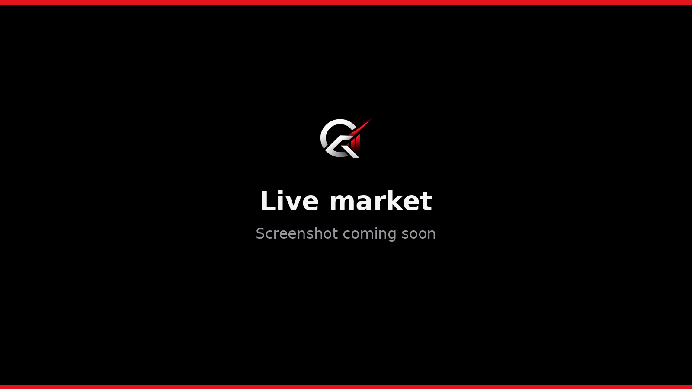</p>

* Ranges from 1 day (1-minute bars) to the full history (weekly bars)
* Scroll to zoom, drag to pan, double-click to reset; adjustable zoom speed
* Market pulse heatmaps, technical analysis, SEC company universe

### 💼 Paper trading

Trade with **$1,000,000 of virtual money** at real prices. Your account is saved and you can
come back to it.

<p align="center">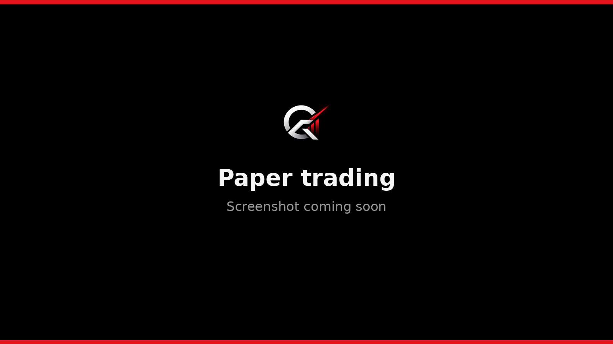</p>

* Market, limit, stop, stop-limit and trailing-stop orders, day or GTC
* Short selling with margin, commissions and slippage, average-cost P&L
* Buy a whole model portfolio in one click and rebalance it
* Board of 14 resizable widgets: quotes, P&L, equity curve, positions, orders, risk

### 🧮 Options: pricing, volatility surfaces, strategies

<p align="center">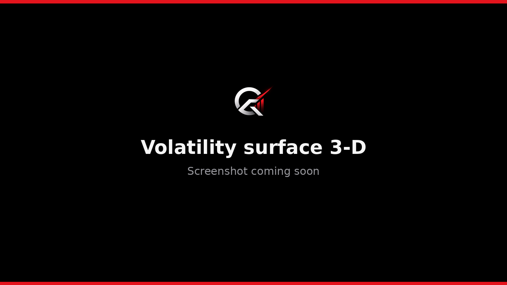</p>

* Black-Scholes-Merton and Greeks, Black-76, implied volatility
* CRR and Leisen-Reimer trees (American), Monte-Carlo with variance reduction, 8 barrier types
* SVI smiles and **3-D implied-volatility surfaces** built from live option chains
* Multi-leg strategy builder, expected move, max pain, open-interest walls

### 🌀 Advanced models: Heston · SABR · jumps

<p align="center">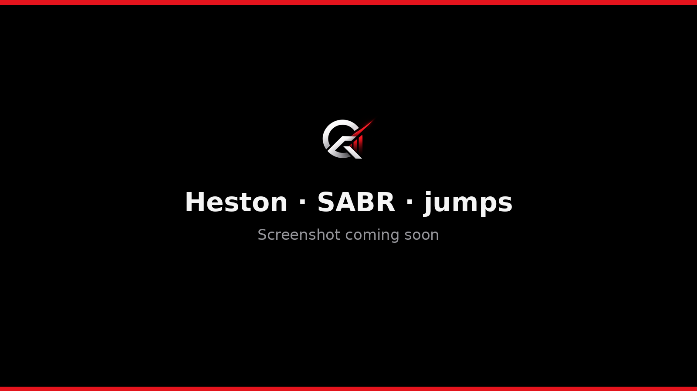</p>

* **Heston** stochastic volatility (semi-analytic and Monte-Carlo)
* **SABR** (Hagan 2002) and **Merton jump-diffusion**
* Calibration to live option chains, with fit diagnostics

### 🔬 Research lab: backtests, Strategy Lab, regimes

<p align="center">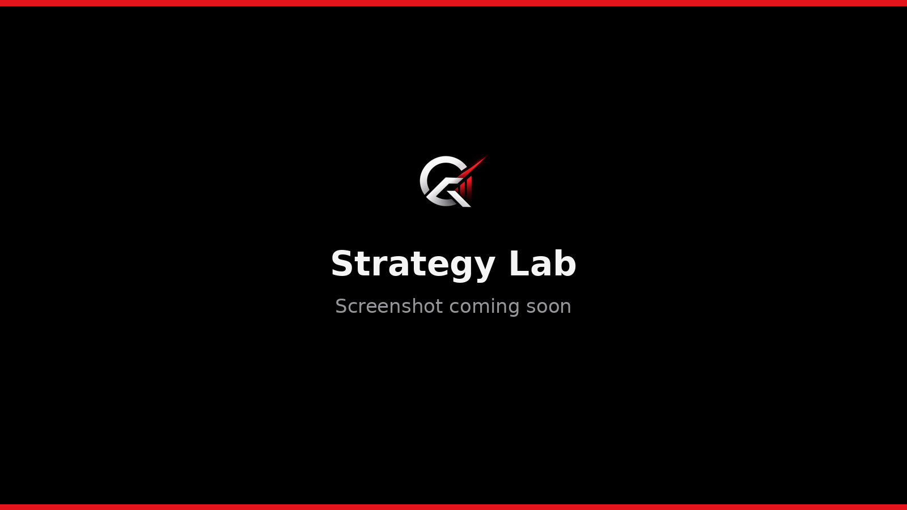</p>

* Backtest engine with no look-ahead, plus transaction costs and a strategy library
* Train/test grid search, walk-forward, pairs trading, trade Monte-Carlo
* **Strategy Lab**: multi-strategy books, diversity score, export of reusable Python code
* **Gaussian HMM regimes** and rotating 3-D return-distribution surfaces

<p align="center">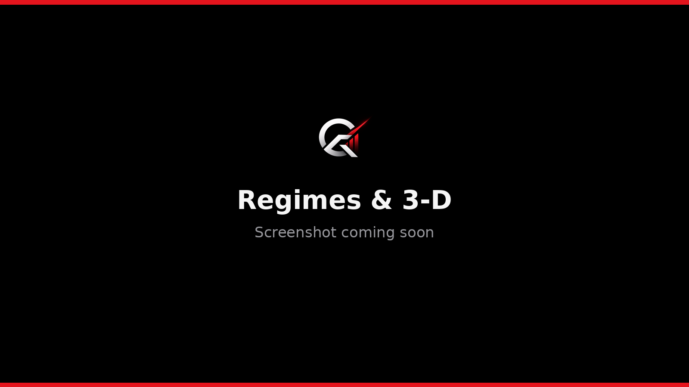</p>

### 📊 Portfolio & risk

<p align="center">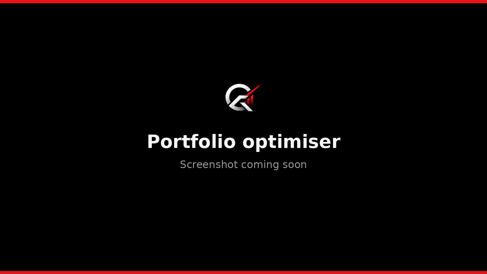</p>

* Markowitz family, Ledoit-Wolf, risk parity, Black-Litterman, CAPM, factor exposures
* Wealth simulator (block bootstrap with real CPI inflation)
* VaR/ES with five methods, component VaR, Kupiec/Christoffersen backtests, Basel zones
* Stress tests that replay real historical crises
* ARMA, GARCH/GJR-t, cointegration; credit models (logistic PD, scorecards, Merton/KMV, Altman Z)

### 🤖 AI copilot

<p align="center">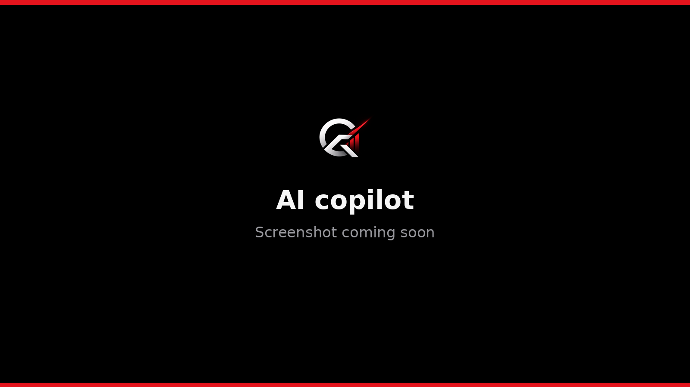</p>

Connect **Claude, ChatGPT or Gemini** with your own API key. The copilot explains every field,
suggests settings, or fills in the page and runs it for you. It needs your permission for each AI,
and it can never see your keys or press delete, reset or export buttons.

### ⚡ C++ engine

<p align="center">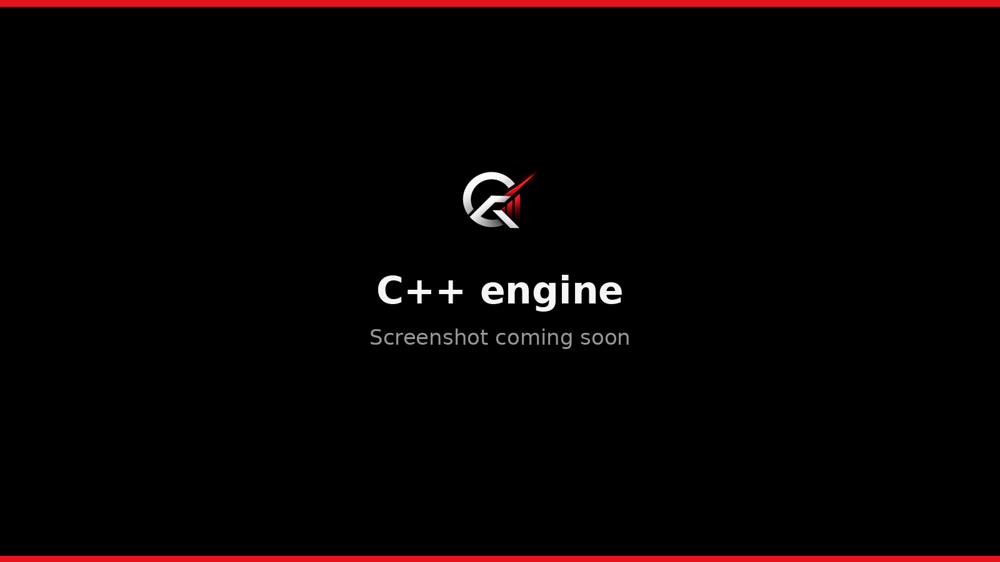</p>

A header-only **C++17** library with Python bindings: Black-Scholes and Greeks, Newton
implied vol, LR/CRR trees and **multithreaded deterministic Monte-Carlo**. It matches the Python
implementation to about 1e-10 and is many times faster.

### 🎓 Academy

<p align="center">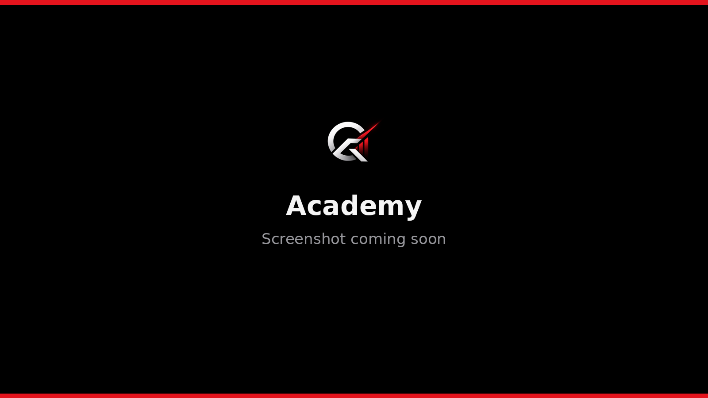</p>

23 chapters across 7 levels: original lessons with cited sources, interactive tools on live data,
**"rewrite it yourself" exercises in Python and C++** with automatic grading, quizzes and
**PDF certificates that anyone can verify**.

<p align="center">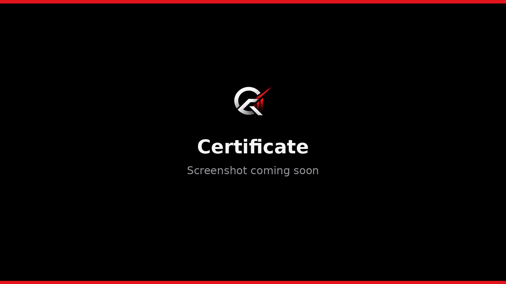</p>

## 🐍 Use it as a library

```bash
pip install -e ".[all]"
```

```python
from quantforge.data import MarketData
from quantforge.pricing import binomial_price, implied_volatility
from quantforge.portfolio import estimate_inputs, max_sharpe
from quantforge.risk import var_report

md = MarketData("yahoo")

# 1. Price a real American put and compare with the market
chain = md.option_chain("AAPL", md.option_expiries("AAPL")[3])
spot, r = md.quote("AAPL"), md.risk_free_rate("3M")
opt = chain[(chain.type == "put")].iloc[(chain[chain.type == "put"].strike - spot).abs().argmin()]
T = opt.days / 365
iv = implied_volatility(opt.mid, spot, opt.strike, T, r, "put")
print(binomial_price(spot, opt.strike, T, r, iv, "put", "american"))

# 2. Max-Sharpe portfolio on 5 years of real prices
rets = md.returns(["AAPL", "MSFT", "JPM", "XOM", "JNJ"], start="2020-01-01")
mu, cov = estimate_inputs(rets)
print(max_sharpe(mu, cov, risk_free_rate=r))

# 3. Tail risk of SPY
print(var_report(md.returns("SPY")["SPY"], confidence=0.99, position_value=1_000_000))
```

Each module is documented in [the tutorials](docs/tutorials):

| Module | Purpose |
|---|---|
| `quantforge.data` | `MarketData` facade (Yahoo, Massive/Polygon, FMP, Alpha Vantage, FRED), intraday, Treasury curve, cache |
| `quantforge.pricing` | BSM, trees, Monte-Carlo, barriers, SVI, strategies, Heston, SABR, Merton |
| `quantforge.portfolio` | Optimisers, Black-Litterman, CAPM, factors, wealth simulator |
| `quantforge.risk` | VaR/ES, backtests, stress tests |
| `quantforge.timeseries` | ARMA, GARCH, ADF, cointegration, indicators, HMM regimes |
| `quantforge.backtest` | Backtest engine, walk-forward, pairs, Strategy Lab |
| `quantforge.credit` | PD models, scorecards, Merton/KMV, Altman Z |
| `quantforge.paper` | Paper-trading engine and saved wallets |
| `quantforge.native` | C++ engine bindings |
| `quantforge.academy` | Curriculum, exercises, certificates |
| `quantforge.viz` | About 40 interactive Plotly charts |

## ⚡ Using the C++ engine

```python
from quantforge import native
native.build()                                            # once
native.bs_price(42, 40, 0.5, 0.10, 0.20, "call")          # 4.759422392871532
native.binomial(50, 50, 5/12, 0.10, 0.40, "put", "american", steps=2001)
native.mc_european(100, 100, 1, 0.05, 0.2, n_paths=4_000_000, seed=7)
native.benchmark()                                        # C++ vs NumPy on identical inputs
```

Or use the headers directly (`src/quantforge/native/cpp`, a CMake project with tests):

```bash
cmake -S src/quantforge/native/cpp -B build && cmake --build build && ctest --test-dir build
```

## 🎓 Academy curriculum

| Level | Chapters |
|---|---|
| 1 · Market Foundations | markets & instruments · orders, bid/ask, liquidity · returns & compounding · reading charts |
| 2 · Risk & Statistics | volatility & drawdowns · fat tails · correlation & beta · rates & bonds |
| 3 · Portfolio Construction | efficient frontier · CAPM & factors · honest backtesting |
| 4 · Derivatives | options & payoffs · Black-Scholes & Greeks · trees & Monte-Carlo · implied vol surfaces |
| 5 · Advanced Risk & Econometrics | VaR/ES & stress tests · ARMA/GARCH · regimes & pairs · credit risk |
| 6 · Capstone | a complete research project |
| 7 · Quant Programming | Python for quants · C++ for quants · build a pricing engine in C++ |


> Certificates attest completion of quantforge content. They are not academic degrees or
> professional qualifications, and quantforge is not an accredited institution.

## ✅ Validation

| Check | Reference | Result |
|---|---|---|
| BS call/put S=42 K=40 r=10% σ=20% T=0.5 | Hull, Ex. 15.6: 4.76 / 0.81 | 4.7594 / 0.8086 |
| American put S=K=50 r=10% σ=40% T=5/12 | Hull, Ex. 21.1: ≈4.28 | 4.2842 (LR, 1001 steps) |
| Put-call parity, Greeks vs finite differences | identities | < 1e-6 |
| Monte-Carlo vs Black-Scholes | closed form | within 3 standard errors |
| MC barriers (BGK) vs Reiner-Rubinstein closed form | closed form | within ~1-2 SE, all 8 types |
| SVI fit on a known surface | round trip | exact recovery |
| GARCH / GJR-t parameters & log-likelihood | `arch` package | match to ~3 decimals |
| ARMA(2,1) estimates & forecasts | `statsmodels` | match to ~3 decimals |
| Logistic regression, OLS (HC1) | `statsmodels` | match to 1e-8 |
| Engle-Granger cointegration & ADF | `statsmodels` coint / adfuller | identical statistic |
| Ledoit-Wolf shrinkage | `scikit-learn` | match to 1e-6 |
| Backtest engine | hand-computed P&L, foresight test | exact; no look-ahead |
| Gaussian HMM regimes | `hmmlearn` | log-likelihood ≥ reference |
| Heston | BS limit, adaptive quadrature, Monte-Carlo, parity | 1e-6 / 1e-8 / within 4 SE / 1e-10 |
| SABR, Merton | flat-vol and no-jump limits, round-trip calibration, Monte-Carlo | exact / 1e-6 / within 4 SE |
| Paper-trading engine | order types, average-cost P&L, margin, persistence | unit tests |
| **C++ engine** vs Python (BS, Greeks, IV, LR/CRR trees) | Python implementation | ≤ 1e-9 relative |
| C++ Monte-Carlo | Black-Scholes; 1 vs 8 threads | within 4 SE; bit-identical |
| Academy exercises | reference solutions / starters | all pass / all fail |

Run them: `pytest -q` (Python) and `ctest` (C++).

## 📚 Documentation

| | |
|---|---|
| 📘 [Tutorials](docs/tutorials) | 10 step-by-step guides on live data |
| 🏗️ [Architecture](docs/ARCHITECTURE.md) | How the pieces fit together |
| 🌐 [Deployment](docs/deployment.md) | Put the web app online with your own domain |
| 🗺️ [Roadmap](ROADMAP.md) · 📝 [Changelog](CHANGELOG.md) | What's next, what changed |
| 🇫🇷 [Lisez-moi](docs/fr/LISEZMOI.md) | French quick start |

## 🤝 Contributing

Contributions are welcome: bug reports, new models, translations, tutorials.
Start with [CONTRIBUTING.md](CONTRIBUTING.md) and look for issues labelled
[`good first issue`](https://github.com/YOUR_GITHUB_USERNAME/quantforge/labels/good%20first%20issue). Please read the
[Code of conduct](CODE_OF_CONDUCT.md). To report a vulnerability, see [SECURITY.md](SECURITY.md).
To cite quantforge, see [CITATION.cff](CITATION.cff).

If quantforge helps you, a ⭐ on the repository helps other people find it.

## 📄 Disclaimer

quantforge is research and educational software, provided as is under the [MIT license](LICENSE).
**Nothing here is investment advice.** Third-party data may be delayed or wrong, and its
providers' terms apply. Yahoo Finance data accessed through `yfinance` is intended for personal use.

---

<p align="center">
  <br>
  Built by <b>Marin J. Ventalon</b> · <a href="https://www.linkedin.com/in/marin-ventalon">LinkedIn</a><br>
  <sub>Made with care in France 🇫🇷</sub>
</p>
