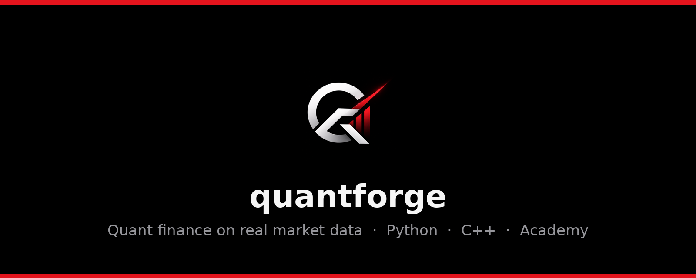

<p align="center">
  
</p>

<p align="center">
  <a href="../../README.md">English</a> · <b>Français</b>
</p>

<p align="center">
  <a href="#-démarrage-rapide"><b>🚀 Démarrage rapide</b></a> ·
  <a href="#-ce-quil-y-a-dedans"><b>🧰 Outils</b></a> ·
  <a href="../tutorials"><b>📚 Tutoriels</b></a> ·
  <a href="https://github.com/mjventalon/quantforge/releases"><b>⬇️ Télécharger</b></a> ·
  <a href="https://www.linkedin.com/in/marin-ventalon"><b>👤 Créateur</b></a>
</p>

---

**quantforge** est une plateforme open source de finance quantitative qui utilise
**uniquement de vraies données de marché**. Elle comprend une librairie Python, un moteur de
calcul **C++17** multithread, une application web de recherche de 25 pages, du **paper trading**
avec 1 000 000 $ virtuels et une **Academy** qui part de zéro jusqu'à l'écriture de votre propre
moteur de pricing, avec des certificats vérifiables.

> **Règle d'or : aucun chiffre inventé.** Cours, chaînes d'options, taux et fondamentaux
> viennent de Yahoo Finance, FRED, Massive (ex-Polygon), FMP ou Alpha Vantage. Chaque donnée
> affiche sa source et son heure de téléchargement. Si une source ne répond pas, l'outil
> affiche l'erreur.

## 🚀 Démarrage rapide

**Sans terminal :** téléchargez le projet (bouton vert **Code** → **Download ZIP**),
décompressez-le, puis double-cliquez sur :

* **Mac** : `Start quantforge.command`. Au premier lancement, faites clic droit → **Ouvrir**,
  car macOS bloque les fichiers téléchargés.
* **Windows** : `Start quantforge.bat`

Le premier lancement installe tout automatiquement, ce qui prend quelques minutes. Python 3.11
ou plus récent doit être installé ([python.org](https://www.python.org/downloads/) ; sous
Windows, cochez *Add Python to PATH*).

**Avec le terminal :**

```bash
git clone https://github.com/mjventalon/quantforge.git
cd quantforge
python -m venv .venv
source .venv/bin/activate
pip install -e ".[all]"
quantforge-app
```

Sous Windows, remplacez la 4e ligne par `.venv\Scripts\activate`. L'application s'ouvre sur
http://localhost:8501.

**Moteur C++ (facultatif) :** installez un compilateur (Mac : `xcode-select --install`), puis
lancez `quantforge-build-native`.

**Clés API (facultatives) :** Yahoo Finance et FRED marchent sans clé. Pour Massive, FMP,
Alpha Vantage ou le copilote IA, copiez `.env.example` en `.env` et collez-y vos clés. Le
fichier `.env` reste sur votre ordinateur et n'est jamais envoyé sur GitHub.

## 🧰 Ce qu'il y a dedans

| Outil | Contenu |
|---|---|
| 📈 **Marché en direct** | Bougies intraday mises à jour automatiquement, historique sur des décennies, indicateurs, cartes de chaleur |
| 💼 **Paper trading** | 1 000 000 $ virtuels sur prix réels, compte sauvegardé, ordres market/limit/stop/stop-limit/trailing, vente à découvert, portefeuilles modèles, 14 widgets |
| 🧮 **Options** | Black-Scholes et grecques, arbres, Monte-Carlo, barrières, smiles SVI, surface de volatilité 3-D, stratégies |
| 🌀 **Modèles avancés** | Heston, SABR, Merton à sauts, calibrés sur de vraies chaînes d'options |
| 🔬 **Laboratoire** | Backtests sans biais d'anticipation, walk-forward, trading de paires, Strategy Lab avec export de code, régimes HMM et surfaces 3-D |
| 📊 **Portefeuille et risque** | Markowitz, parité de risque, Black-Litterman, VaR/ES, stress tests de crises réelles, GARCH, crédit |
| 🤖 **Copilote IA** | Claude, ChatGPT ou Gemini avec votre propre clé : il explique chaque champ, suggère des réglages ou remplit la page pour vous |
| ⚡ **Moteur C++** | Black-Scholes, volatilité implicite, arbres et Monte-Carlo multithread, beaucoup plus rapides que Python |
| 🎓 **Academy** | 23 chapitres, 7 niveaux, quiz, exercices à réécrire en Python et en C++, certificats PDF vérifiables |

Les captures d'écran de chaque outil sont dans le [README en anglais](../../README.md#-whats-inside).

## 🐍 Exemple en Python

```python
from quantforge.data import MarketData
from quantforge.risk import var_report

md = MarketData("yahoo")
r = md.returns("SPY", start="2015-01-01")["SPY"]
print(var_report(r, confidence=0.99, position_value=1_000_000))
```

Les tutoriels détaillés (en anglais) sont dans [`docs/tutorials`](../tutorials).

## 📄 Avertissement

quantforge est un logiciel de recherche et d'enseignement, fourni tel quel sous licence MIT.
**Rien ici n'est un conseil en investissement.** Les données de tiers peuvent être retardées ou
erronées.

---

<p align="center">
  Créé par <b>Marin J. Ventalon</b> · <a href="https://www.linkedin.com/in/marin-ventalon">LinkedIn</a>
</p>
